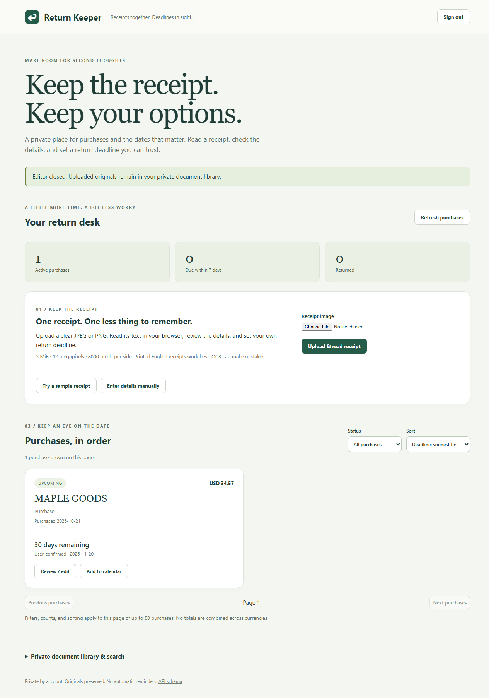

# Return Keeper: live demo and portfolio walkthrough

**Test the website:** https://cloud-document-api.onrender.com/app/

**Source:** https://github.com/kevincyril/cloud-document-api

The landing page is public; create your own account to try the tracker. Receipts
and purchases are private to that account. Refreshing the page signs you out
because the JWT is held only in browser memory.

## Two-minute demo

1. Open the live website and choose **New here? Create an account**. Register with
   a unique email and a password of at least eight characters.
2. Choose **Try a sample receipt**. This is a clearly labeled synthetic image,
   not a real transaction. It uses the same private upload and actual browser OCR
   as your own JPEG/PNG files.
3. Compare the original with the suggested merchant, purchase date, total, and
   currency. Correct any mistakes; the original OCR stays separate.
4. Choose **A return window in days**, enter **30**, and review the calculation.
   Select whether purchase day counts, check the confirmation box, and save.
   This is a demonstration of your own supplied window, not a store policy claim.
5. Find the saved purchase card. Open **Review / edit**, inspect the private
   original, and try **Download original**.
6. Choose **Add to calendar** to download an all-day `.ics` event. Importing it
   creates a calendar event; the app does not schedule email or other reminders.
7. Change the purchase date or return window. The form proposes a new date but
   requires confirmation before changing the saved deadline. Try the **Returned**
   checkbox and dashboard status filter.

If OCR is cancelled, fails, or leaves ambiguous values blank, enter the details
manually. Real receipts may contain personal data: start with the synthetic
sample, and use your own files only if you are comfortable uploading them to
your private workspace. Supported images are JPEG/PNG up to 5 MiB, 12 megapixels,
and 8000 pixels per side. Handwriting and scanned-PDF OCR are not supported.

## Screenshots

These screenshots show the deployed app with synthetic data only.

[Mobile dashboard screenshot](screenshots/mobile.png)

## Portfolio copy

> Built and deployed a private receipt and return-deadline tracker using
> TypeScript, Express, PostgreSQL, browser-side Tesseract.js OCR, and private
> Supabase Storage. Implemented editable OCR suggestions, exact money handling,
> calendar-date deadlines with explicit confirmation, account ownership checks,
> image validation, and all-day calendar export. Verified the complete flow in
> real browsers with synthetic receipts and cross-account isolation tests.

Use the live link, source link, and screenshots above in a portfolio entry.
There is no external portfolio website configured in this repository, so no
third-party portfolio page has been edited or published.

## Verification and remaining hands-on checks

- Edge/Chromium: full local browser suite and live receipt workflow passed.
- Google Chrome: full local receipt/document suite passed on October 21, 2026.
- Firefox: actual OCR, saving, private preview/download response, calendar
  response, cancellation, narrow layout, and account isolation passed locally.
- Mobile: responsive layout verified at 390 pixels; a real phone has not been tested.
- Real printed receipts: not benchmarked; only synthetic images were supplied.
- Google Calendar/Outlook: `.ics` content and browser export are tested; import
  into a personal calendar account has not been performed.

For the last checks, use your phone to follow the same demo, try a clear printed
receipt you own, and import the exported event into your calendar. Confirm the
event remains on the chosen date. These checks need the actual device, receipt,
or calendar account; they cannot be replaced by a screenshot or synthetic test.

The two accounts, single receipt original, and purchase created by this release's
live smoke test have been removed after verification. The screenshots remain as
synthetic demonstration assets; no real receipt or account credential is included.
